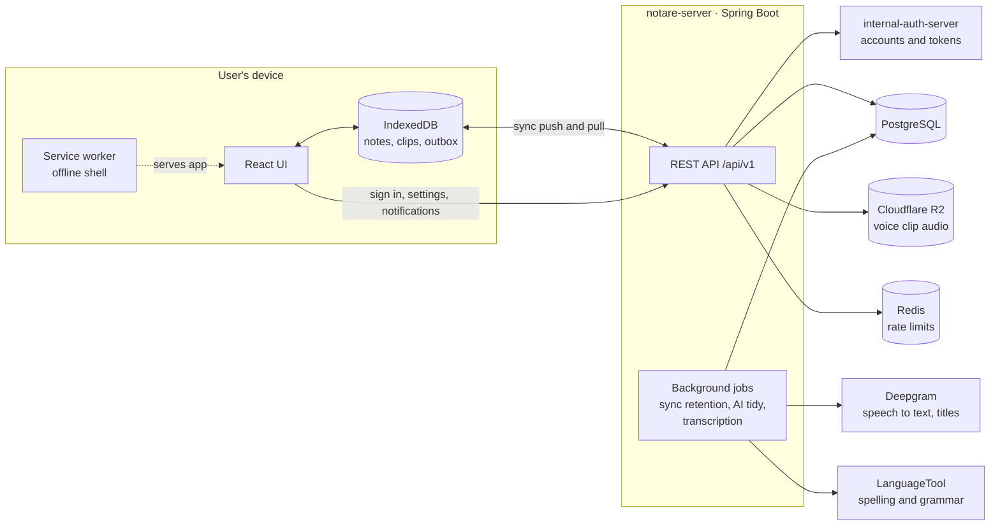
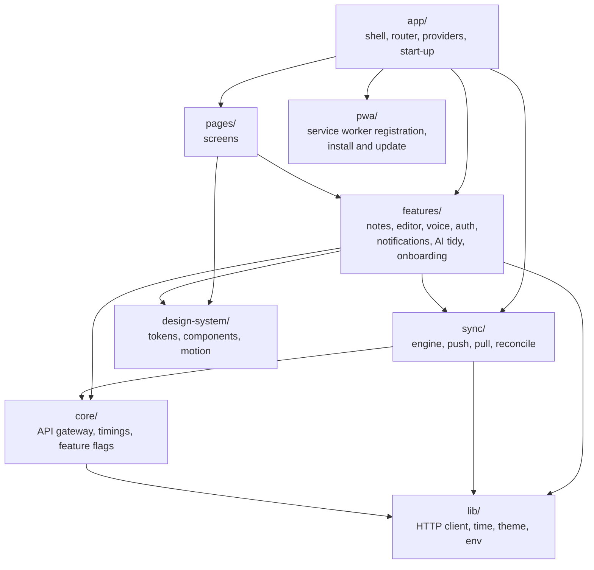
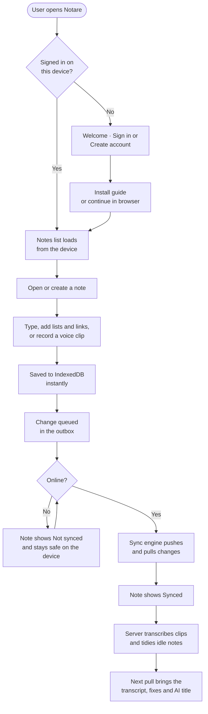
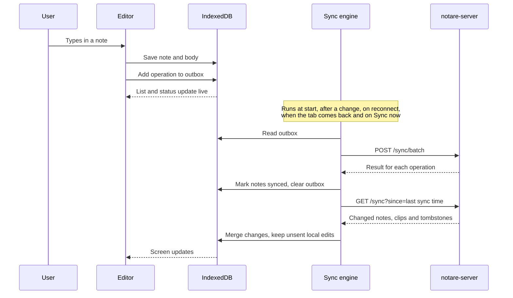
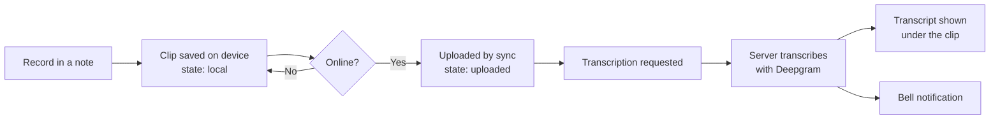
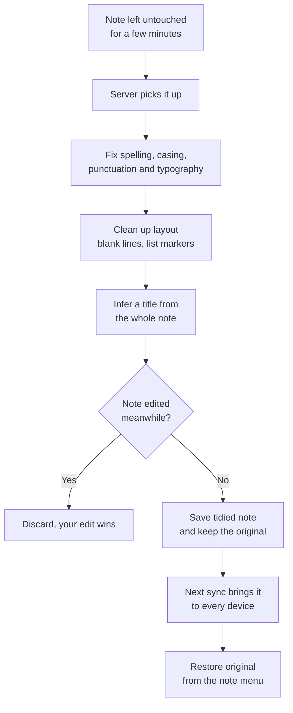

<div align="center">


# Notare

**An offline-first, installable notes app. Write, record voice clips and get them transcribed, with every note saved on your device first and synced when you are online.**

[](#progressive-web-app)
[](#technology-stack)
[](#technology-stack)
[](#technology-stack)
[](#offline-first-and-sync)

</div>

---

## Table of Contents

1. [Project Overview](#project-overview)
2. [The Problem](#the-problem)
3. [The Solution](#the-solution)
4. [Features](#features)
5. [Technology Stack](#technology-stack)
6. [System Architecture](#system-architecture)
7. [Client Architecture](#client-architecture)
8. [Folder Structure](#folder-structure)
9. [Application Workflow](#application-workflow)
10. [Offline First and Sync](#offline-first-and-sync)
11. [Voice Clips and Transcription](#voice-clips-and-transcription)
12. [AI Tidy](#ai-tidy)
13. [Progressive Web App](#progressive-web-app)
14. [Installation](#installation)
15. [Environment Variables](#environment-variables)
16. [Scripts](#scripts)
17. [Build for Production](#build-for-production)
18. [Deployment](#deployment)
19. [Quality and Testing](#quality-and-testing)
20. [Browser Support](#browser-support)
21. [Future Improvements](#future-improvements)
22. [Author](#author)
23. [Acknowledgements](#acknowledgements)

---

## Project Overview

**Notare** is a notes app built for writing in any condition: on a train, in a basement, on a flaky mobile connection. This React application is the client half of a two-part system. It holds your notes on the device, gives you the editor, records voice clips and keeps everything in step with a companion [Spring Boot backend](https://github.com/EzeDev98/notare-server), which stores notes, runs transcription and tidies notes in the background.

This repository contains **only the client application**. The server has its own repository and documentation.

**Who it's for:** anyone who wants to capture a thought the moment it comes, by typing or by speaking, without waiting for a page to load or worrying whether the note will be lost when the signal drops.

**Why it exists:** most web note apps treat the network as a given. They show a spinner while saving, lose a draft when a tab closes offline, or refuse to open at all without a connection. Notare treats the device as the source of truth and the server as a backup and sync partner, so writing never waits on the network.

---

## The Problem

- **Notes get lost offline.** Many web editors keep the draft only in memory until the server answers. Close the tab while offline and the note is gone.
- **Saving waits on the network.** A spinner on every keystroke makes writing feel slow and fragile.
- **Voice notes are hard to search.** An audio clip is useful in the moment and hard to find again later.
- **Quick notes are messy.** Notes typed in a hurry are full of typos and have no useful title, so the list becomes a wall of first lines.
- **Web apps feel temporary.** Without installation, a notes app lives in a browser tab that is easy to close and hard to find.

---

## The Solution

- **Local first.** Every change is written to IndexedDB on the device before anything else happens. The screen reads from the device, never from the network, so it opens and works with no connection at all.
- **Background sync.** Changes go into an outbox and a sync engine sends them when the device is online, then pulls what changed on other devices. The latest edit wins, and the person never resolves a conflict by hand.
- **Voice clips inside notes.** Record straight into a note. The clip is stored on the device first, uploaded later, and transcribed by the server.
- **AI tidy.** When a note has been left alone for a while, the server corrects spelling and punctuation, cleans up the layout and gives the note a title. Your own edits always win, and the original can be restored.
- **Installable.** Notare is a Progressive Web App with an offline shell, so it installs to the home screen or dock and opens like a native app.

---

## Features

- Rich-text note editor with paragraphs, bullet lists, numbered lists and links
- Voice clips recorded inside a note, with playback and per-clip delete
- Server-side transcription of voice clips, shown under each clip
- AI tidy: background spelling and punctuation fixes, layout cleanup and an AI-written title, with "Restore original"
- Notes grouped into Pinned, Today, Yesterday and older, with search across text and transcripts
- Pin, copy, restore original and delete from a context menu (right-click, long press or the more button)
- Works fully offline; a status word on each note says whether it is saved and synced
- Sync page with status, last synced time, storage use and "Sync now"
- Free up space by removing synced voice clips from the device
- Download voice clips on Wi-Fi only (optional)
- Light, dark and system themes
- Notifications for finished transcriptions
- Guided install flow for Chrome, Edge and Safari
- Update prompt when a new version of the app is ready
- "Reset this device" to wipe local data after a final sync
- Accessible: keyboard navigation, screen-reader labels and reduced-motion support

---

## Technology Stack

| Layer | Technology |
|---|---|
| UI | React 19, React Router 8 |
| Language | TypeScript 6 |
| Build | Vite 8 |
| Editor | Tiptap 3 on ProseMirror |
| Note body | Yjs documents stored per note |
| Local storage | IndexedDB through Dexie 4 |
| Online-only data | TanStack Query 5 (notifications) |
| Design system | Own components on PatternFly 6 tokens, Lucide icons |
| Offline shell | Hand-written service worker |
| Testing | Vitest 4, Testing Library, MSW 2, fake-indexeddb, axe-core |
| Code quality | ESLint with layer-boundary rules, Stylelint with design-token rules, Prettier |

---

## System Architecture

Notare is three services. The client talks only to the Notare server. The server verifies sign-ins against a separate identity service, internal-auth-server.



---

## Client Architecture

The code is split into layers, and ESLint enforces which layer may import which. Screens never call the network or the database directly; they use hooks from a feature, and features use the shared infrastructure underneath.



**The rules that matter:**

- `lib/` knows nothing about the app. `design-system/` is presentation only.
- Pages and feature components never speak HTTP, touch the database or drive the sync engine. They subscribe through hooks.
- Every path lives in `app/routes.ts`, every timing in `core/config/timings.ts` and every colour, size and duration in `design-system/tokens.css`.

---

## Folder Structure

```
notare-client/
├── public/                  # Icons, logos, fonts, manifest, offline page
├── service-worker/
│   └── sw.js                # Offline shell and authenticated clip streaming
├── src/
│   ├── app/                 # Shell, router, providers, start-up, status banner
│   ├── core/                # Note-server gateway, timings, feature flags
│   ├── design-system/       # Tokens, base styles, UI components, motion
│   ├── dev/                 # Dev-only gallery, tokens and motion pages
│   ├── features/
│   │   ├── aiTidy/          # AI tidy setting
│   │   ├── auth/            # Session, tokens, sign-in and registration logic
│   │   ├── editor/          # Tiptap editor, note body, voice clip blocks
│   │   ├── notes/           # Local database, repositories, list, status
│   │   ├── notifications/   # Notification list and unread count
│   │   ├── onboarding/      # Install checks and words
│   │   └── voice/           # Recording, playback, upload, transcription
│   ├── lib/                 # HTTP client, errors, time, theme, env
│   ├── pages/               # Home, note detail, settings, auth, onboarding
│   ├── pwa/                 # Service worker registration, install, update
│   ├── shared/hooks/        # Small reusable hooks
│   ├── sync/                # Sync engine, push, pull, reconcile, status
│   └── main.tsx
├── tests/                   # Test harness, fixtures and mock API
├── vite-plugins/            # PatternFly CSS layer, service worker versioning
├── eslint.config.js         # Lint rules, including layer boundaries
├── stylelint.config.js      # CSS rules that enforce design tokens
├── vite.config.ts
└── package.json
```

---

## Application Workflow



---

## Offline First and Sync

The device is the source of truth. The screen reads from IndexedDB through live queries, so it updates the moment anything is written, whether the change came from the person or from the server.



**How it stays safe:**

- **One outbox row per note.** Repeated edits to the same note collapse into one pending operation, so a long offline session does not build a huge queue.
- **Idempotent operations.** Each operation carries an id, and the server records what it has applied, so a retry after a dropped connection is never applied twice.
- **Unsent edits are never overwritten.** A pulled note does not replace a local note that still has changes waiting to be sent.
- **Tombstones.** Notes deleted for good on another device are removed here too, even after a long time offline.
- **Back-off.** After repeated failures the engine waits longer between tries and the Sync page says it is paused.
- **Storage full.** If the device runs out of space, a banner explains it and offers to free space by removing synced voice clips.

---

## Voice Clips and Transcription



- Clips are recorded with `MediaRecorder` in a format the server accepts, stored on the device first and uploaded by the sync engine.
- A clip can be deleted on its own without deleting the note.
- Playback of clips that are only on the server is streamed through the service worker, which adds the access token.
- On metered connections, clip downloads can be limited to Wi-Fi.

---

## AI Tidy

AI tidy is an opt-in setting under **Settings › General**. It runs entirely on the server.



- The AI title is shown centred at the top of the note and used in the list. It is stored apart from the note text.
- Tidying is silent: no pop-ups, no toasts. An open note is never swapped out under the cursor.
- "Restore original" brings back the exact text from before the tidy.

---

## Progressive Web App

A **Progressive Web App (PWA)** is a website that can be installed and behave like a native app: its own window, an icon on the home screen or dock, and the ability to open without a connection.

Notare uses a hand-written service worker rather than a generated one:

- **Offline shell.** The app's files are precached at install, so Notare opens with no connection.
- **Versioned caches.** Each build stamps a new cache version, and old caches are cleared on activation.
- **Update flow.** A new version installs in the background. The app offers **Reload** when it is ready, and confirms the new version after the reload.
- **Guided install.** The install screen uses the browser's install prompt where it exists (Chrome, Edge) and shows step-by-step instructions where it does not (Safari on iPhone and iPad).
- **Authenticated streaming.** Voice clip streams go through the service worker, which attaches the access token.

---

## Installation

**Prerequisites:** Node.js 22.12 or later, and a running [notare-server](https://github.com/EzeDev98/notare-server).

```bash
# clone the repository
git clone https://github.com/EzeDev98/notare-client.git
cd notare-client

# install dependencies
npm install

# copy the environment template and adjust it
cp .env.example .env.local

# start the development server
npm run dev
```

The dev server proxies `/api/*` to the Notare server, so no CORS setup is needed during development.

---

## Environment Variables

| Variable | Used by | Description |
|---|---|---|
| `VITE_API_BASE_URL` | Browser | Where the API lives. `/api/v1` in development (proxied); an absolute URL in production, for example `https://api.example.com/api/v1`. |
| `VITE_SERVER_TIME_ZONE` | Browser | The server's time zone as an IANA name, for example `Africa/Lagos`. Used to read server timestamps correctly. |
| `NOTARE_DEV_PROXY_TARGET` | Dev server only | Where `/api/*` is forwarded during `npm run dev`. Defaults to `http://localhost:2001`. |

Every `VITE_` variable is built into the public bundle. Never put a secret in one.

---

## Scripts

| Command | What it does |
|---|---|
| `npm run dev` | Start the dev server |
| `npm run build` | Type-check, then build for production |
| `npm run preview` | Serve the production build locally |
| `npm run typecheck` | Type-check only |
| `npm run lint` | ESLint and Stylelint |
| `npm run lint:fix` | ESLint with automatic fixes |
| `npm run format` / `format:check` | Prettier |
| `npm test` / `test:watch` | Vitest |

---

## Build for Production

```bash
npm run build
```

The output goes to `dist/`: a static single-page app plus `sw.js`. Preview it with `npm run preview`.

---

## Deployment

The build is a static site, so any static host works (Render static site, Netlify, Vercel, Cloudflare Pages, Nginx).

- Set the build command to `npm run build` and the publish directory to `dist/`.
- Set `VITE_API_BASE_URL` and `VITE_SERVER_TIME_ZONE` in the host's environment before building.
- Serve `index.html` for every unknown path, because the app uses client-side routing.
- Serve `sw.js` without long-lived caching, so updates reach users promptly.
- Add the deployed origin to the server's CORS allow-list.

---

## Quality and Testing

- **Unit and integration tests** with Vitest and Testing Library, against a real IndexedDB implementation (fake-indexeddb) and a mock API (MSW) that intercepts at the network layer.
- **Accessibility checks** with axe-core in tests.
- **Architecture enforced by lint.** ESLint rules stop screens from calling the network, the database or the sync engine directly, keep `lib/` and `design-system/` independent of the app, and keep files short.
- **Design enforced by lint.** Stylelint rules stop raw colours, pixel sizes and one-off font weights, so every value comes from the token file.
- **Strict TypeScript** throughout.

---

## Browser Support

Recent versions of Chrome, Edge, Firefox and Safari, on desktop and mobile. The app needs IndexedDB, service workers and `MediaRecorder` for voice clips. The one-tap install prompt is available in Chromium browsers; Safari users install through the Share menu, and the app shows them how.

---

## Future Improvements

- Shared notes and live collaboration between people
- Sync of voice clips across devices without a full download
- End-to-end encryption of note content
- Tags and folders
- Export to Markdown and PDF
- Reminders on notes

---

## Author

**Eze Moses John** · [Building with Eze on YouTube](https://www.youtube.com/@buildingwitheze?sub_confirmation=1)

---

## Acknowledgements

- [Tiptap](https://tiptap.dev/) and [ProseMirror](https://prosemirror.net/): the editor
- [Yjs](https://yjs.dev/): the note body document format
- [Dexie](https://dexie.org/): IndexedDB made pleasant
- [PatternFly](https://www.patternfly.org/) and [Lucide](https://lucide.dev/): design foundations and icons
- [Deepgram](https://deepgram.com/) and [LanguageTool](https://languagetool.org/): transcription, titles and corrections on the server
